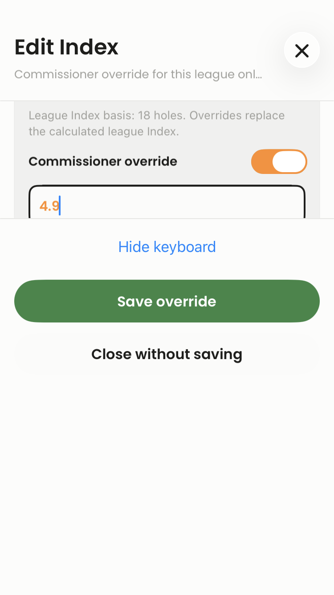
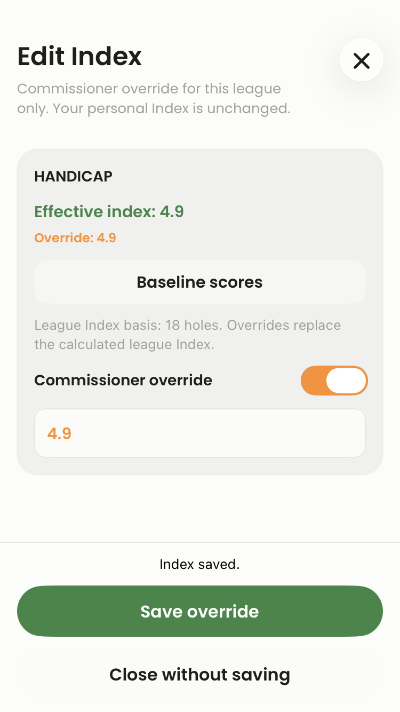
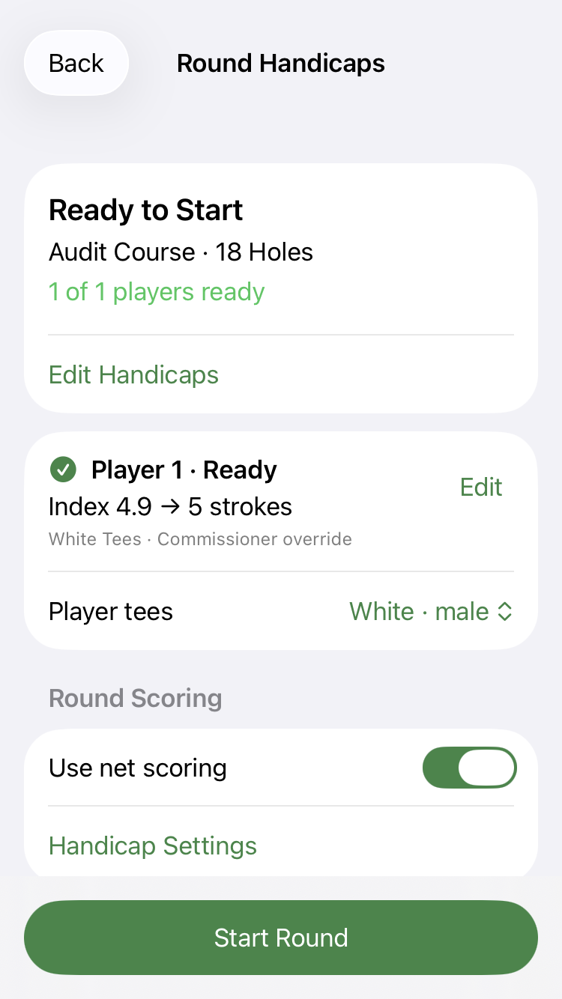

# Commissioner Index and per-player tees

Scope: [Save override](https://app.clickup.com/t/wdx6zf77zq), [Series tees](https://app.clickup.com/t/wdx6zf77zr), [override/tee independence](https://app.clickup.com/t/wdx6zf77zt), and [Edit Index](https://app.clickup.com/t/wdx6zf6vm2). The normal-priority Fixed Handicap settings ticket is excluded.

## Base and overlapping work

This change is based on PR #18, `6087a48d`, branch `codex/consolidated-rc-2026-10-21`. PRs #14–#17 and #18 were inspected before implementation. #18 contains their existing Index-basis, source handling, course identity, round-start review, manual-strokes, and snapshot protections. The original checkout contains unrelated uncommitted changes and was left untouched. The new PR targets #18's branch so reviewers see only this task's changes.

## Fixes and causes

| Ticket | Root cause | Fix |
| --- | --- | --- |
| Hidden Save | `SeriesMemberEditorSheet` put the actual Save override inside scroll content. The footer's Done closed the sheet, the toggle could persist immediately, and save failures were only logged. | Move Save override into the persistent footer. Give keyboard dismissal its own Hide keyboard action and label cancellation explicitly. Keep the draft on failure, display the result, and update effective Index only after successful persistence. Turning an override off also requires Save. |
| Series tees | Start Round showed the tee picker only inside the non-Series Index/manual-strokes editor. Applying a Series-method draft discarded the tee together with the round-only handicap input. | Always expose each player's tee picker. Persist `player_tee_box_ids` separately from `handicap_inputs`, including local drafts, planned-round saves, creation payloads, and lobby synchronization. Old documents default to an empty dictionary. |
| Overrides block tees | The same Series-method condition hid tees for commissioner Index overrides. The linked lobby also updated tee identity without refreshing its saved Course HCP. | Keep the Index source intact while resolving the selected tee with the existing calculator. An unstarted linked lobby rebuilds the tee-dependent snapshot and computed allowance, retaining intentional manual strokes. Started/completed snapshots remain unchanged. Invalid data produces a reason instead of silently applying an allowance. |
| Undiscoverable Index edit | The roster chip already opened Handicap Details, but that view only exposed Add score. | Add authorized Edit Index directly below the current Index. Reuse `SeriesMemberEditorSheet` in its Index-focused mode. Missing values and members with zero scores can receive a league override without fabricated baseline scores. |

Override saves now enforce commissioner/league permissions and validate input before writing. A Firestore transaction compares the previously loaded override with the current persisted version, including the first-write case, to reject stale replacement. The editor also detects newer listener values before starting a write. A failed/conflicting save retains the text and explains retry/reopen options. Saving does not change member tees, personal profiles, other leagues, or historical snapshots.

No handicap formulas, maximum-Index policy, normalization, stroke-allocation rules, or score-entry rules were changed. Nine-hole league bases and personal 18-hole Indexes continue through the existing resolver. The native design palette and SwiftUI controls are reused.

## Changed files

- `SeriesMemberEditorSheet.swift`, `SeriesBaselineScoresView.swift`: shared editor, persistent actions, save feedback, and direct Edit Index routing.
- `SeriesViewModel.swift`, `Firebase+Series.swift`: explicit save results, permission checks, conflict detection, injected test persistence, and round tee persistence.
- `Series.swift`, `SeriesRuntimeStore.swift`: backward-compatible tee storage and semantic invalidation.
- `CourseSelectionForSeriesRoundSheet.swift`: source-independent tee pickers and distinct provenance labels.
- `SeriesRoundCreationMapping.swift`, `SeriesRoundCreationService.swift`, `SeriesRoundSyncPlanning.swift`, `SeriesRoundSyncService.swift`: independent tee choices through preview, planned persistence, creation, and sync.
- `Round+Participant.swift`, `ManagePlayerView.swift`: lobby tee recalculation while retaining Index/manual strokes and respecting started-round locks.
- `SeriesRoundStartAuditTests.swift`: ten new regressions using the production views, draft/save logic, creation mapper, calculator, and scoring engine. Existing source-label expectations now reflect the explicit provenance labels.
- `.github/workflows/score-carousel-tests.yml`: include commissioner and affected Series mapping, sync, Codable, maximum-Index, and override suites.

## Regression coverage

The new tests cover:

- Enter 4.9 with the numeric keyboard active; explicit Save, keyboard dismissal without saving, failed persistence, retry, cancellation, and reopening.
- Authorized Edit Index for missing/overridden values and no action for ordinary members.
- Eight-player mixed tees (five blue, three white), calculated/overridden Index sources, registered/offline players, full/front/back segments, serialization and snapshot provenance.
- Planned save/reopen, failed planned persistence, permission denial, stale override versions, stale tee identity, and started/completed locks.
- Personal Index versus explicit manual strokes; changing tees without inventing or changing an Index.
- Linked lobby tee recalculation with preserved manual strokes and frozen live/completed snapshots.
- Offline commissioner workflow: save 4.9 with zero scores, select blue tees, persist/reopen planned setup, create the production participant payload, and verify net scoring with `ScoringEngine.computeStrokePlay` for all three segments.

Existing affected suites cover standard-round tee changes, registered/offline personal entry, keyboard behavior, Index bases, frozen snapshots, league maximums, and Series creation/sync.

## Validation

- iPhone SE (3rd generation), iOS 26.3, Sandbox, Address Sanitizer enabled: **59 passed, 0 failed, 0 skipped**. Command completed successfully; result: `/private/tmp/HackersCommissionerSmallVerified.xcresult`.
- Build and test compilation succeeded with the existing Sandbox scheme, `ONLY_ACTIVE_ARCH=YES`, and `COMPILER_INDEX_STORE_ENABLE=NO`. Compiler indexing is unrelated to runtime checks; the scheme's Address Sanitizer remains enabled.
- Full available unit target on iPhone 17 Pro / iOS 26.3: **1,180 passed, 0 failed, 5 existing opt-in skips (1,185 total)**. This includes XCTest and Swift Testing cases. `test-without-building` completed successfully against the final compiled source; result: `/private/tmp/HackersCommissionerFull.xcresult`.
- The inherited scheme also has a legacy `HackersTests` reference. An explicit attempt to run that name was rejected because it is not a member of the actual test plan/scheme, and there is no corresponding source directory. No available test was disabled.
- Exact commands and machine-readable counts: [validation.json](validation.json).
- `git diff --check`: passed.

The newly created SE simulator initially lacked `AccessibilityEnabled` and `ApplicationAccessibilityEnabled`, unlike the existing test simulator; 15 hosted UI tests could not inspect their controls. Matching those simulator inspection preferences resolved those failures. One existing UI test also needed to scroll to its offscreen field on the smaller viewport; after adapting the test, the complete 59-test suite passed.

Screenshots of the real hosted production views:

The capture above renders the hosted app window; the system keyboard is in a separate window. The test separately asserts a nonzero software-keyboard frame and that the Save button's bottom is above its top, then invokes Save while the field remains first responder.

An intermediate affected-suite run reported **292 passed, 0 failed, 0 skipped**, but Xcode could not finish saving its result bundle because the disk filled. It is not treated as a clean successful test invocation. Task-owned disposable packages, superseded failed result bundles, and compiler intermediates were removed; source and final test products/results were retained.

## Acceptance limits

Persistence in the regression fixtures is injected or serialized locally. No customer/production records were written and no backend was deployed. The user subsequently authorized pushing PR #19 and an internal Sandbox TestFlight deployment; the release receipt below records that separate action. Physical-device keyboard presentation and authenticated Firebase save/reload/listener/concurrent-commissioner acceptance still require testing. The Firestore transaction compiles against the installed SDK; its live backend behavior is not claimed as tested. The workflow fixture validates production payload creation and net scoring, rather than creating a live customer round.

## PR-ready summary

Commissioners can save league Index overrides with the keyboard open and open the same editor directly from Handicap Details. Every Start Round player has a tee selector regardless of handicap source. Tee choices persist independently through planned drafts and participant creation, while the lobby recalculates tee-dependent Course HCP without changing the Index or manual round strokes. Existing round locks, basis/source rules, and scoring logic are retained.

## Authorized TestFlight deployment

The user subsequently authorized committing/pushing, creating PR #19, and deploying Hackers Compete Test. [PR #19](https://github.com/kylebeard56/Hackers-Compete-iOS/pull/19) is open.

**Hackers Compete Test 1.0.0 (2026.10.21.3) is available to internal Beta testers.** Apple confirms **VALID / IN_BETA_TESTING**, audience **INTERNAL_ONLY**, build ID `9d719fa8-c736-46da-9a77-ebe31c9d98a3`. The existing internal Beta group has access to all builds. External build state is NOT_APPLICABLE.

The archive contains application source commit `bc76855bdfe49d860b1b36ca39d4a0b2e8db7da3`. Sandbox app and Live Activity bundle IDs, versions, signatures, and matching application dSYMs were verified. The exported IPA uses the existing Apple Distribution certificate and cached Xcode-managed App Store profiles, with internal-only TestFlight export enabled. `altool` reported no upload errors; the App Store Connect API independently confirmed availability. The Mac was locked, so the successful upload used the existing API key after an offline cached-profile export. No new signing certificate or provisioning profile was created.

Archive, IPA, and original logs are preserved in `/Users/Kirsten/Developer/Hackers-Combined/build-artifacts/commissioner-ux-2026-10-21/`. Release hashes and receipt: [testflight-release.json](testflight-release.json). Fresh Apple state: [testflight-apple-status.json](testflight-apple-status.json). Live Firebase/device acceptance remains manual; this deployment does not certify those workflows.

## Production TestFlight — 2026-10-22

The user authorized Production distribution to both internal and external beta testers using Fastlane. **Hackers Compete 1.0.0 (2026.10.22.1)** was archived, signed, and uploaded with the repository’s Fastlane 2.230.0 deployment lane. Apple confirms **VALID**, **APP_STORE_ELIGIBLE**, and internal **IN_BETA_TESTING**. The existing internal **Beta** group has access to all builds. Build ID: `d006390d-0e6d-4c96-ae41-16600d562309`.

**Testing notes are updated and independently verified in Apple’s en-US beta build localization.** [Device testing checklist](TESTFLIGHT-CHECKLIST.md).

External distribution to **Beta Testers** is complete. After the user signed in, the build was assigned to that external group and submitted through App Store Connect with **Automatically notify testers** enabled. Apple confirms **APPROVED**, internal **IN_BETA_TESTING**, and external **IN_BETA_TESTING**. The page shows the internal Beta group (2 testers) and external Beta Testers group (45 testers). [Distribution confirmation](testflight-groups-confirmed.png). The API key permission failure was resolved by the authorized signed-in browser submission; the binary upload and testing notes were completed with Fastlane.

The archive includes iPhone app, Watch app, and Live Activity with Production bundle IDs, build 2026.10.22.1, verified signatures, and matching dSYMs. Source commit: `774b6ad1f3df601bebf970d2bb61a954e6e9b2aa`. The newer release-base commit changes only CI/documentation. No application code changed for this deployment. Physical-device and authenticated Firebase acceptance remain manual.

Release receipt: [testflight-production-release.json](testflight-production-release.json). Archive, IPA, symbols, and logs: `/Users/Kirsten/Developer/Hackers-Combined/build-artifacts/production-commissioner-2026-10-22/`.
